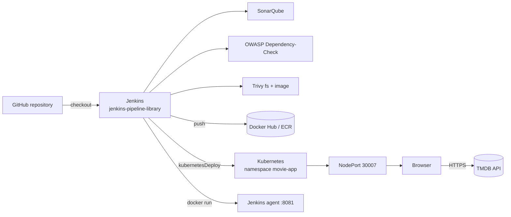

# DevSecOps Pipeline: Jenkins, SonarQube, OWASP Dependency-Check and Trivy

A DevSecOps delivery pipeline for a React + TypeScript single-page application that browses movies through
the TMDB API. Every change goes through code-quality, dependency, filesystem and image security gates before
a non-root container image is published and deployed to Kubernetes or to a Docker container on the Jenkins
agent.

This repository is based on an existing open-source tutorial project (see [Attribution](#attribution)). The
React application is upstream code; the pipeline, container, Kubernetes, security and CI layers were
reworked in this repository.

## Table of Contents

- [Project Overview](#project-overview)
- [Key Features](#key-features)
- [Architecture Overview](#architecture-overview)
- [Changes Compared to the Upstream Project](#changes-compared-to-the-upstream-project)
- [Technology Stack](#technology-stack)
- [Project Structure](#project-structure)
- [Prerequisites](#prerequisites)
- [Installation and Configuration](#installation-and-configuration)
- [Execution and Deployment](#execution-and-deployment)
- [Testing and Validation](#testing-and-validation)
- [CI/CD Pipeline](#cicd-pipeline)
- [Security Implementation](#security-implementation)
- [Optional Monitoring](#optional-monitoring)
- [Screenshots](#screenshots)
- [License](#license)
- [Attribution](#attribution)
- [Author](#author)

## Project Overview

```text
Install → Type check + build → SonarQube + Quality Gate → OWASP Dependency-Check → Trivy fs
  → Docker build → Trivy image → Push (Docker Hub | ECR) → Deploy (Kubernetes | container | none)
  → Optional e-mail report
```

## Key Features

- **Blocking gates.** The SonarQube Quality Gate, OWASP Dependency-Check (CVSS ≥ 7) and Trivy (HIGH/CRITICAL)
  fail the build. Reports are archived.
- **Dependency audit in CI.** `yarn audit` fails the GitHub Actions build on high or critical advisories in
  production dependencies.
- **Hardened runtime.** `nginx-unprivileged` on port 8080, read-only root filesystem, `restricted` Pod
  Security Standard, liveness and readiness probes on `/healthz`.
- **Immutable images.** `<build>-<git sha>` tags, on Docker Hub or Amazon ECR.
- **Repeatable deployments.** The container stage replaces the previous container. The Kubernetes stage waits
  for the rollout and rolls back on failure.

## Architecture Overview



The application is a static bundle served by nginx. The browser calls the TMDB API directly.

## Changes Compared to the Upstream Project

| Area | Upstream | This repository |
|---|---|---|
| Pipeline | `pipeline.txt` tutorial pipeline with non-blocking scans and hard-coded registry user and e-mail | `Jenkinsfile` built on `jenkins-pipeline-library` (`v1.0.0`) with blocking gates, placeholders and optional e-mail |
| Dependencies | Vite 3, TypeScript 4.6, React Router 6 | Vite 7, TypeScript 5.9, React Router 7, pinned transitive fixes (`resolutions`) |
| Image | `node:16` build, nginx running as root on port 80 | `node:22-alpine` build, `nginx-unprivileged` on 8080, SPA routing, security headers, `/healthz` |
| Secrets | `.env` committed, TMDB key passed as `--build-arg KEY=value` | `.env` untracked, key injected from a Jenkins credential without command-line exposure |
| Kubernetes | `latest` tag, root user, no probes or resources | Namespace with `restricted` Pod Security, immutable tag, probes, resources, read-only root filesystem |
| Repository hygiene | `yarn.lock` ignored by `.gitignore` | Fixed. Added `.dockerignore`, Gitleaks configuration, Dependabot and CI |
| Documentation | Single tutorial README | This README, plus the original tutorial edited into `docs/infrastructure-setup-guide.md` |

## Technology Stack

| Area | Tools |
|---|---|
| Application (upstream) | React 18, TypeScript 5, Vite 7, Redux Toolkit, MUI 5, React Router 7, Video.js |
| Runtime | Node.js 22 (build), nginx (`nginxinc/nginx-unprivileged`) |
| Containers and orchestration | Docker (BuildKit), Kubernetes |
| CI/CD | Jenkins, GitHub Actions, Dependabot |
| Quality and security | SonarQube (SonarScanner CLI), OWASP Dependency-Check, Trivy, `yarn audit`, kubeconform, Gitleaks |
| Optional (setup guide only) | Prometheus, Grafana, node-exporter, Argo CD |

## Project Structure

```text
.
├── src/ public/ index.html          # React application (upstream)
├── package.json yarn.lock           # Dependencies (upgraded)
├── vite.config.ts tsconfig*.json    # Build configuration (upstream)
├── Dockerfile nginx.conf            # Production image
├── Jenkinsfile                      # DevSecOps pipeline
├── sonar-project.properties         # SonarScanner configuration
├── k8s/                             # 00-namespace, 20-deployment, 30-service
├── monitoring/                      # Optional node-exporter Service
├── docs/infrastructure-setup-guide.md
├── .env.example
├── .trivyignore .gitleaks.toml .gitleaksignore
└── .github/                         # CI workflow, Dependabot
```

## Prerequisites

- Node.js 22.12 or newer and Yarn 1.x (local development)
- Docker with BuildKit enabled
- A TMDB API key (free account on The Movie Database)
- For the pipeline: Jenkins, SonarQube, Trivy, Docker and `kubectl`.
  `docs/infrastructure-setup-guide.md` describes how to install them on an EC2 instance.

## Installation and Configuration

```bash
git clone https://github.com/ElloughWassim/devsecops-jenkins-trivy-sonarqube.git
cd devsecops-jenkins-trivy-sonarqube
yarn install --frozen-lockfile
cp .env.example .env        # then set VITE_APP_TMDB_V3_API_KEY
```

| Setting | Where |
|---|---|
| `VITE_APP_TMDB_V3_API_KEY`, `VITE_APP_API_ENDPOINT_URL` | `.env` (local) / `TMDB_V3_API_KEY` build argument (image) |
| Registry namespace, AWS account and region, notification e-mail | `environment` block of the `Jenkinsfile` |
| SonarQube project key and sources | `sonar-project.properties` |
| NodePort | `k8s/30-service.yaml` (`30007`) |

## Execution and Deployment

```bash
# Development server
yarn dev                                                    # http://localhost:5173

# Production image
docker build --build-arg TMDB_V3_API_KEY="$TMDB_KEY" -t movie-app .
docker run --rm -p 8080:8080 movie-app                      # http://localhost:8080

# Kubernetes (manual)
sed 's|IMAGE_PLACEHOLDER|<registry>/movie-app:<tag>|' k8s/20-deployment.yaml > /tmp/movie-app.yaml
kubectl apply -f k8s/00-namespace.yaml -f /tmp/movie-app.yaml -f k8s/30-service.yaml
# http://<node-ip>:30007
```

## Testing and Validation

The upstream application has no automated test suite. The existing checks are:

```bash
yarn build                                        # TypeScript type check (tsc) + production build
yarn audit --groups dependencies --level high     # dependency advisories (same command as CI)
```

CI also smoke-tests the container (`/healthz` and the SPA entry point on `/browse`).

## CI/CD Pipeline

### Jenkins (`Jenkinsfile`)

| Parameter | Values |
|---|---|
| `REGISTRY` | `dockerhub` (immutable tag + `latest`) or `ecr` (immutable tag only) |
| `DEPLOY_TARGET` | `kubernetes` (apply `k8s/`), `container` (run on the Jenkins agent, port 8081), `none` |

- **Plugins:** Pipeline, Git, Credentials Binding, NodeJS, SonarQube Scanner, OWASP Dependency-Check,
  Email Extension, Timestamper, and Pipeline: AWS Steps (or AWS Credentials) for ECR.
- **Tools:** NodeJS installation `node22`, SonarScanner `sonar-scanner`, Dependency-Check
  `dependency-check`. The agent also needs Yarn, Docker, Trivy and `kubectl` (plus the AWS CLI v2 for ECR).
- **SonarQube:** server named `sonarqube`, with a webhook to `<JENKINS_URL>/sonarqube-webhook/`.
- **E-mail:** set `NOTIFY_EMAIL` in the `Jenkinsfile` to receive the build result with the log and Trivy
  reports attached. Leave it empty to disable notifications.

| Credential ID | Kind | Purpose |
|---|---|---|
| `tmdb-api-key` | Secret text | TMDB key for the image build |
| `dockerhub-credentials` | Username with password (access token) | Docker Hub push |
| `aws-credentials` | AWS Credentials | ECR push |
| `kubeconfig` | Secret file | Kubernetes deployment |
| `nvd-api-key` | Secret text | NVD API key for Dependency-Check |

### GitHub Actions (`.github/workflows/ci.yml`)

Runs on pushes to `main` and on pull requests:

| Job | Checks |
|---|---|
| Type check, build and audit | `yarn install --frozen-lockfile`, `yarn build`, `yarn audit` (high) |
| Docker image, smoke test and Trivy | Image build with a dummy key, smoke test, Trivy image scan (fixable HIGH/CRITICAL), Trivy fs scan (vulnerabilities, secrets, misconfigurations, MEDIUM and above) |
| Kubernetes validation | kubeconform on `k8s/` and `monitoring/` |
| Secret scan | Gitleaks over the full history |

Dependabot checks npm, Docker and GitHub Actions dependencies weekly.

## Security Implementation

- **The TMDB key is public by design.** Vite inlines `VITE_*` variables into the JavaScript bundle, so any
  visitor can read the key. Use a dedicated, read-only TMDB key. A private key would require a backend proxy.
- **Key injection.** In Jenkins, the key comes from the `tmdb-api-key` credential and is passed to
  `docker build` by name only, so its value never appears on the command line.
- **Historical secrets.** The upstream Git history contains TMDB API keys committed in 2022–2023 by previous
  authors. They are not used here and are absent from the current tree. The history is kept intact, and
  `.gitleaksignore` lists only those historical fingerprints, so any new leak still fails CI. The original
  key owners should revoke them.
- **Container and pod.** Non-root UID 101, port 8080, read-only root filesystem (only `/tmp` is writable),
  no service-account token, all capabilities dropped, `RuntimeDefault` seccomp profile.
- **nginx.** `server_tokens off`, `X-Content-Type-Options`, `X-Frame-Options` and `Referrer-Policy` headers.
- **Exceptions.** `.trivyignore` documents the only accepted exception (`KSV-0013`, the image placeholder).

## Optional Monitoring

`monitoring/node-exporter-service.yaml` exposes a Prometheus node-exporter installed with Helm in the
`prometheus-node-exporter` namespace. It is not part of the application deployment. Prometheus, Grafana and
Argo CD are only covered by `docs/infrastructure-setup-guide.md` and are not automated by this repository.

## Screenshots

Application screenshots from the upstream project are stored in `public/assets/`:

| Home page | Detail modal | Genre grid |
|---|---|---|
|  |  |  |

## License

**No license file is present in this repository, and no license has been identified for the upstream
project.** Without a license, the upstream code remains under the exclusive copyright of its original
authors. No license is granted for this repository at this time.

## Attribution

- **Upstream project:** DevSecOps-Project by N4si (CloudChamp), source
  [N4si/DevSecOps-Project](https://github.com/N4si/DevSecOps-Project). The React application, its assets and
  the original tutorial come from this project. `docs/infrastructure-setup-guide.md` is that tutorial,
  lightly edited.
- **Data:** this product uses the TMDB API but is not endorsed or certified by TMDB.
- **Trademarks:** "Netflix" and the Netflix logo are trademarks of Netflix, Inc. This project is a
  non-commercial educational clone and is not affiliated with or endorsed by Netflix.
- **Work in this repository by ElloughWassim:** `Jenkinsfile`, `Dockerfile`, `nginx.conf`, `k8s/`,
  `.github/`, `sonar-project.properties`, `.dockerignore`, Gitleaks and Trivy configuration, dependency
  upgrades and this README.

## Author

Maintained by **ElloughWassim** · [github.com/ElloughWassim](https://github.com/ElloughWassim)
