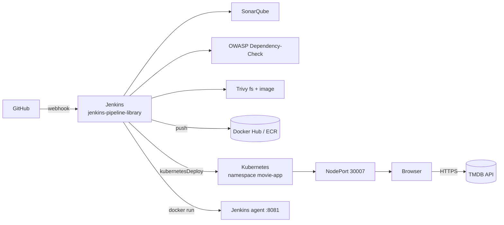

# DevSecOps Pipeline: Jenkins, SonarQube, OWASP Dependency-Check and Trivy

[](https://github.com/ElloughWassim/devsecops-jenkins-trivy-sonarqube/actions/workflows/ci.yml)

A DevSecOps delivery pipeline for a React + TypeScript single-page application that browses movies through the
[TMDB API](https://developer.themoviedb.org/). Every change goes through code-quality, dependency, filesystem
and image security gates before a non-root container is published and deployed to Docker or Kubernetes.


## Project overview

```
Code ─▶ Type check + build ─▶ SonarQube + Quality Gate ─▶ OWASP Dependency-Check ─▶ Trivy fs
     ─▶ Docker build ─▶ Trivy image ─▶ Push (Docker Hub | ECR) ─▶ Deploy (Kubernetes | container) ─▶ E-mail report
```

## Main features

- **Gates that block:** the SonarQube Quality Gate, Dependency-Check (CVSS ≥ 7) and Trivy (HIGH/CRITICAL)
  all fail the build. Reports are archived.
- **Clean dependency tree:** upgraded from 121 known advisories (2 critical, 66 high) to **0** (`yarn audit`).
- **Hardened runtime:** `nginx-unprivileged`, read-only root filesystem, `restricted` Pod Security, probes.
- **Immutable images:** `<build>-<git sha>` tags, on Docker Hub or Amazon ECR.
- **Repeatable deploys:** the container stage replaces the previous container, and the Kubernetes stage waits
  for the rollout and rolls back on failure.

## Technologies and tools

React 18 · TypeScript 5 · Vite 7 · Redux Toolkit · MUI · Node.js 22 · nginx · Docker · Kubernetes · Jenkins ·
SonarQube · OWASP Dependency-Check · Trivy · Gitleaks · GitHub Actions · Dependabot · Prometheus/Grafana and
ArgoCD (optional, see the setup guide)

## Architecture overview



The application is a static bundle served by nginx. The browser calls TMDB directly.

## What this fork changes

| Area | Before (upstream) | After (this fork) |
|---|---|---|
| Pipeline | `pipeline.txt` with a syntax error (an inline `#` comment), non-blocking scans, hard-coded Docker Hub user and personal e-mail | `Jenkinsfile` on [jenkins-pipeline-library](https://github.com/ElloughWassim/jenkins-pipeline-library) with blocking gates, placeholders and optional e-mail |
| Dependencies | Vite 3, TS 4.6, React Router 6.9 (121 advisories) | Vite 7, TS 5.9, React Router 7, pinned transitive fixes (0 advisories). UI code unchanged |
| Image | `node:16` (EOL), nginx as root, port 80 | `node:22-alpine` build, `nginx-unprivileged` on 8080, SPA routing, security headers, `/healthz` |
| Secrets | `.env` committed, TMDB key baked in via `--build-arg KEY=value` on the command line | `.env` untracked, key injected from a Jenkins credential without command-line exposure |
| Kubernetes | `latest` tag, root, no probes or resources | Namespace with `restricted` PSS, immutable tag, probes, resources, read-only rootfs |
| Repo hygiene | `.gitignore` ignored the committed `yarn.lock` | Fixed. Added `.dockerignore`, gitleaks config, Dependabot, CI |
| Docs | Single tutorial README with logos | This README, plus the tutorial edited into [`docs/infrastructure-setup-guide.md`](docs/infrastructure-setup-guide.md) |

## Repository structure

```
.
├── src/ public/ index.html         # React application (upstream, unchanged)
├── package.json yarn.lock          # Dependencies (upgraded)
├── vite.config.ts tsconfig*.json   # Build configuration (upstream)
├── Dockerfile nginx.conf           # Production image
├── Jenkinsfile                     # DevSecOps pipeline (was pipeline.txt)
├── sonar-project.properties        # SonarScanner configuration
├── k8s/                            # 00-namespace, 20-deployment, 30-service
├── monitoring/                     # Optional node-exporter Service (see setup guide)
├── docs/infrastructure-setup-guide.md
├── .trivyignore .gitleaks.toml .gitleaksignore
└── .github/                        # CI workflow, Dependabot
```

## Prerequisites

- Node.js 22.12+ and Yarn 1.x (local development)
- Docker 24+ with BuildKit
- A TMDB API key: [create one here](https://www.themoviedb.org/settings/api)
- For the pipeline: Jenkins, SonarQube, Trivy, Docker and `kubectl`. The
  [setup guide](docs/infrastructure-setup-guide.md) walks through installing them on EC2.

## Installation

```bash
git clone https://github.com/ElloughWassim/devsecops-jenkins-trivy-sonarqube.git
cd devsecops-jenkins-trivy-sonarqube
yarn install --frozen-lockfile
cp .env.example .env        # then set VITE_APP_TMDB_V3_API_KEY
```

## Configuration

| Setting | Where |
|---|---|
| `VITE_APP_TMDB_V3_API_KEY`, `VITE_APP_API_ENDPOINT_URL` | `.env` (local) / `TMDB_V3_API_KEY` build argument (image) |
| Registry namespace, AWS account and region, notification e-mail | `environment` block of the `Jenkinsfile` |
| SonarQube project | `sonar-project.properties` |
| NodePort | `k8s/30-service.yaml` (`30007`) |

## How to run the project

```bash
yarn dev                                                    # http://localhost:5173

docker build --build-arg TMDB_V3_API_KEY="$TMDB_KEY" -t movie-app .
docker run --rm -p 8080:8080 movie-app                      # http://localhost:8080

sed 's|IMAGE_PLACEHOLDER|<registry>/movie-app:<tag>|' k8s/20-deployment.yaml > /tmp/movie-app.yaml
kubectl apply -f k8s/00-namespace.yaml -f /tmp/movie-app.yaml -f k8s/30-service.yaml
```

## How to execute tests

The upstream application has no automated test suite. The checks that exist are:

```bash
yarn build                    # TypeScript type check (tsc) + production build
yarn audit --level high       # dependency vulnerabilities
```

CI also smoke-tests the container (`/healthz` and the SPA entry point). Adding unit tests (Vitest + Testing
Library) is listed under remaining work.

## CI/CD pipeline

### Jenkins setup

- **Plugins:** Pipeline, Git, Credentials Binding, NodeJS, SonarQube Scanner, OWASP Dependency-Check,
  Email Extension, Timestamper, and Pipeline: AWS Steps for ECR.
- **Tools:** NodeJS installation `node22`, SonarScanner `sonar-scanner`, Dependency-Check `dependency-check`.
  The agent also needs Docker, Trivy and kubectl.
- **SonarQube** server `sonarqube`, with a webhook to `<JENKINS_URL>/sonarqube-webhook/`.
- **Credentials:**

| Id | Kind | Purpose |
|---|---|---|
| `tmdb-api-key` | Secret text | TMDB key for the image build |
| `dockerhub-credentials` | Username + access token | Docker Hub push |
| `aws-credentials` | AWS Credentials | ECR push |
| `kubeconfig` | Secret file | Kubernetes deployment |
| `nvd-api-key` | Secret text | Dependency-Check NVD updates |

Parameters: `REGISTRY` (`dockerhub` | `ecr`), `DEPLOY_TARGET` (`kubernetes` | `container` | `none`).

### GitHub Actions

`ci.yml` runs on every push and pull request:
- build and type check
- `yarn audit` (high)
- Docker build and smoke test
- Trivy image and fs/IaC scans
- kubeconform
- gitleaks over the full history

## Security considerations

- **The TMDB key is public by design.** Vite inlines `VITE_*` variables into the JavaScript bundle, so any
  visitor can read the key. Use a dedicated, read-only TMDB key. For a private key, add a small backend proxy.
- **Historical secrets.** The upstream history contains TMDB API keys committed in 2022-2023 by previous
  authors. They are not used here and are gone from the current tree. Because this is a fork, the history
  is kept as is. `.gitleaksignore` lists only those historical fingerprints, so any *new* leak still fails CI.
  The original key owners should revoke them.
- Container: non-root UID 101, port 8080, read-only root filesystem (only `/tmp` is writable), no
  service-account token, all capabilities dropped, `RuntimeDefault` seccomp, security headers, `server_tokens off`.
- `.trivyignore` documents the only accepted exception (the image placeholder in the manifest).

## License and attribution

**No license.** The upstream repository has no license, so this fork does not grant one either: the code
remains under its authors' copyright. It is published as a GitHub fork, which GitHub's Terms of Service allow.

- **React application:** commit history shows `pydjangodev` and Endo Aki (2022) as the original authors.
- **DevSecOps tutorial and original pipeline:** [N4si](https://github.com/N4si/DevSecOps-Project), with
  contributions from [Aj7Ay](https://github.com/Aj7Ay).
- **Pipeline, container, Kubernetes, CI and security hardening in this fork:** ElloughWassim.
- Movie data and images: [TMDB](https://www.themoviedb.org/). This product uses the TMDB API but is not
  endorsed or certified by TMDB.
- The UI imitates a well-known streaming service for learning purposes. It is not affiliated with or endorsed
  by that company, and its trademarks belong to their owners.

## Maintainer

Fork maintained by **ElloughWassim**, [github.com/ElloughWassim](https://github.com/ElloughWassim).
